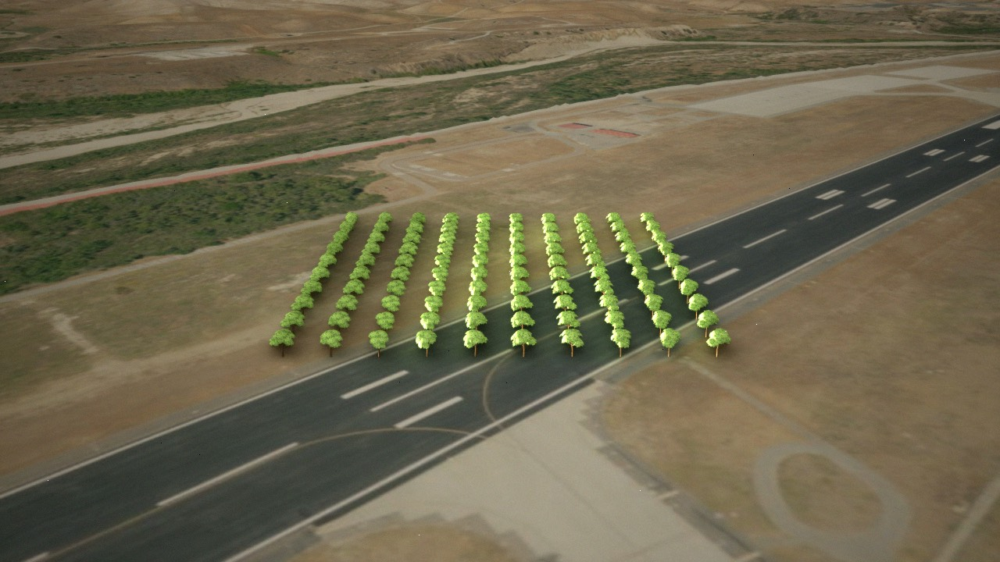
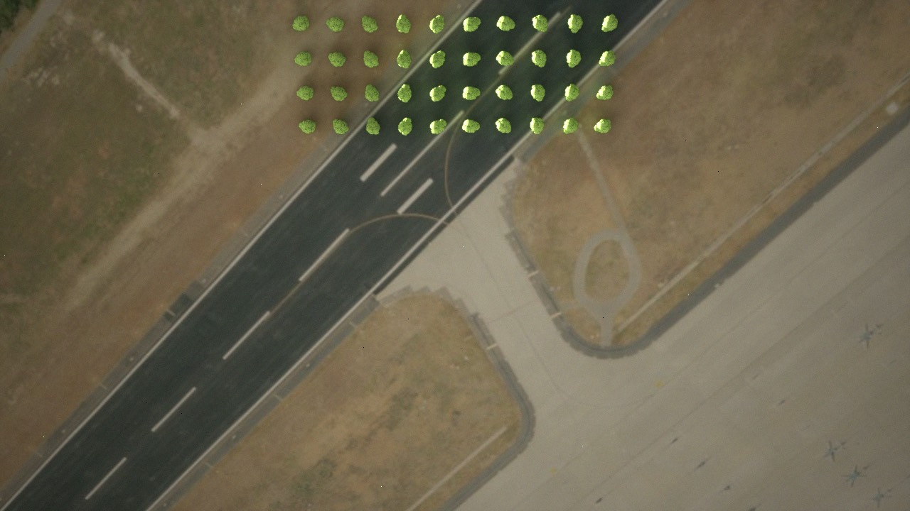
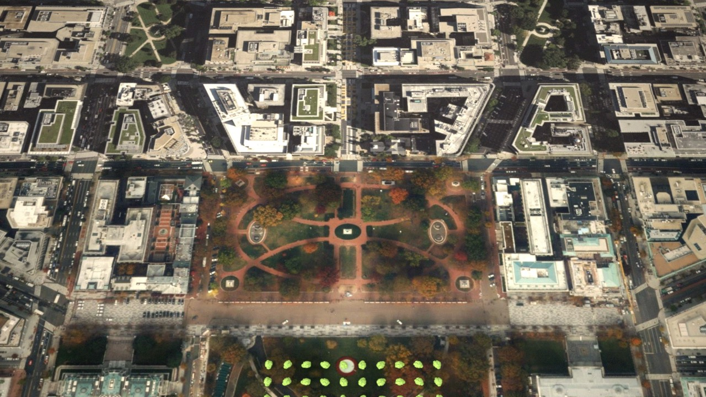
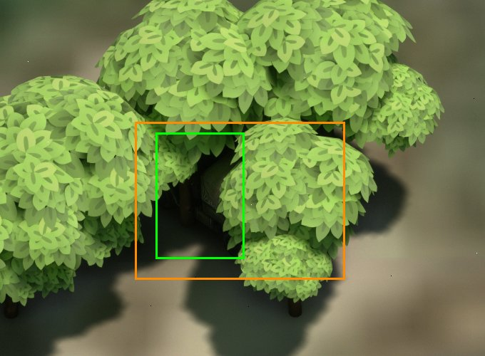

# Vegetation (trees and shrubs)

REALISM R4. Instanced trees and shrubs scattered around the camera from land cover, a per-package species mix and, where
the scene package has it, CHMv2 canopy cover and height; loaded at runtime from a mounted vegetation library (glTF through
glTFRuntime) into HISMs. A near tier (full meshes, shadows) out to `radius_m` and a far tier (low-poly, thinned) out to
`far_radius_m`. Specs: the slice
[`superpowers/specs/2026-10-10-r4-trees-slice-design.md`](superpowers/specs/2026-10-10-r4-trees-slice-design.md) and
"deeper" [`superpowers/specs/2026-10-11-r4-vegetation-deeper-design.md`](superpowers/specs/2026-10-11-r4-vegetation-deeper-design.md)
(plans beside them in `superpowers/plans/`).

The same 100 m cell always holds the same trees and shrubs, whichever way the camera got there. Vegetation is scene
geometry only: visible in EO and IR (in IR the pixel takes the land cover's class: `tree_canopy` on 10, `shrubland` on
20, `grassland` on 30) and occluding entities in the ground-truth masks, but CIGI and DIS never see it.

## How it works

- **Grid** (`Vegetation/VegetationGrid.h`): a global geographic grid of `cell_size_m` cells (100 m),
  defined in angle so a cell id `(row, col)` never depends on the camera: Δlat = cell / 111,320 m, Δlon
  per latitude row = cell / (111,320 m · cos(row centre latitude)). No vegetation above 85° latitude.
- **Species mix** (`Vegetation/VegetationMix.h`): per land-cover code, the library types that stand there and their
  weights, trees and shrubs separately, plus shrubs per 100 m². From the package's `vegetation/mix.json` (its
  `[vegetation]` table, [`scene-packages.md`](scene-packages.md#vegetation-mix-r4)), else `vegetation.mix_file`, else the
  built-in default: 10 → `tree_broadleaf_a` (R4's trees bit for bit), 20 → `shrub_chaparral` at 6 / 100 m², 30 → at
  1 / 100 m². A type the library lacks is dropped with one warning (the code renormalised); with `scene.offline: true`
  CamSim exits 1. Names are taken in alphabetical order, so the JSON key order never matters.
- **Trees** (`Vegetation/VegetationScatter.h`, pure, `GenerateCellContent`): each cell is a jittered grid of
  `round(cell / 6 m)` = 17 candidates per axis (**real spacing 5.88 m**). Candidate *i* draws from
  `CamSimHash::Hash(col, row, i, seed, 160 + k)` (the PCG hash of the sensor noise, never a live RNG): jitter E/N inside
  its own sub-cell (so trees never cross cell edges), species (165, from the code's mix), acceptance, yaw, scale.
  - **With canopy** (the package's `canopy/` covers the point): no tree below 3 m canopy height or at no cover; else
    scale base s = clamp(height / type height, 0.5, 2) and p = clamp(cover × 34.6 m² / (π (r_crown s)²) × density, 0, 1),
    so the expected crown area per candidate equals the canopy cover. It **saturates** at one crown per 34.6 m²:
    π r² / 34.6 ≈ 0.66 cover for the 2.7 m broadleaf crown (≈ 290 trees/ha); closed forest above that is drawn at the
    cap. Scale s × (0.9–1.1). Trees stand on every code whose mix lists trees (oaks on grassland, street trees on 50).
  - **Without canopy** (no layer, `canopy_enabled: false`, or outside the package bbox): R4's rule, p = 0.15 × density
    (one tree per 231 m² of mix code) and scale 0.8–1.2.
- **Shrubs**: their own grid of `round(cell / shrub_spacing_m)` = 33 per axis (3.03 m), sub-streams 166–171 (jitter,
  accept, yaw, scale, species): accepted with p = shrubs per 100 m² / 100 × 9.18 m² × density on codes whose mix lists
  shrubs, scale 0.7–1.3. Shrubs ignore the canopy (CHMv2 doesn't resolve them) and may stand under trees. Only in the
  near tier, culled at `shrub_radius_m`.
- **Land cover and canopy at points** (`VegetationLandCover.h`, `VegetationCanopy.h`): the scatter reads the package's
  `landcover/` and `canopy/{cover,height}/` tiles itself, on a worker, each through its own 16-tile LRU of
  `FLandCoverTileCache` (never the CIGI lookup's game-thread budget). A bad tile reads as no data there; the caches'
  summary warnings reach the log once a second.
- **Seed:** the scene package manifest's `seed` mixed with a vegetation constant (`VegetationSeed`);
  `vegetation.seed` only when there is no package. Pendleton's package has manifest seed 0, which gives vegetation seed
  186258786 (as `vegetation.seed: 0` does).
- **Heights (near):** one `ACesium3DTileset::SampleHeightMostDetailed` batch per cell (trees then shrubs) on the terrain
  tileset (the one tagged `CamSimTerrain`, never the buildings tileset). A failed sample drops that plant only.
- **Plants stay out of buildings** (REALISM R3 / R3b; `vegetation.drop_in_buildings`, default true, gates all of it).
  Land cover alone would put ~10 % of footprint area under trees (WorldCover tags canopy over roofs as code 10: on
  Pendleton 10.4 % of the 23.0 km² of footprints, about 10,400 trees at density 1, and a 7–11 m tree would poke its
  crown through a 3–8 m flat roof). In order of preference:
  1. **Footprint mask** (a package built with R3b: `features/buildings/mask/index.json` exists):
     `FVegetationBuildingMask` decodes the 1-bit mask tiles on the scatter worker into bitsets (8-tile LRU, ~23 MB,
     separate from the land-cover sampler). `GenerateCellContent` drops a tree or shrub whose trunk, or any of 4 points
     `vegetation.building_clearance_m` (2 m) east, west, north and south of it, is masked (the 5-point rule). No
     runtime sampling; the hash draws are unchanged, so without a mask every cell is bit-identical. The probes
     are axis-aligned: a footprint corner diagonally within the clearance is not seen. It applies whether or not the
     buildings tileset is drawn (`scene.buildings.enabled`), since the roofs are in the imagery either way. A mask
     whose `index.json` is unusable logs one `Vegetation: building mask unusable (...); falling back` warning and the
     next method is used.
  2. **Runtime check** (an R3 package: buildings tileset, no mask): each cell's height stage runs a second
     `SampleHeightMostDetailed` batch on the tileset tagged `CamSimBuildings` for the same points, beside the terrain
     batch; both must answer (or the stage times out, as above) before the cell spawns. A plant whose buildings sample
     succeeds more than 0.5 m above its terrain height is dropped (`CamSimVegetation::KeepClearOfBuildings`); a failed
     sample is a miss and keeps it. Cesium loads the buildings' most detailed (z15) tiles under every point
     to answer it: in `dense_pass` it costs about +0.3 ms game p50, +2.5 ms game p95 and +34 MiB.
  3. Neither (no mask, no buildings tileset): no exclusion.
- **Bad mask tiles:** a tile that is listed but unreadable (a git LFS pointer, the wrong size, truncated, missing)
  reads as "no buildings" there and logs one `Vegetation: building mask tile ... unreadable (...); treated as no
  buildings` warning per tile. A failed tile is remembered and not retried, so restart after `git lfs pull`.
- **Blocks and tiers** (`Vegetation/VegetationBlocks.h`): streaming works in blocks of `far_block_cells` × cell size
  (400 m). A cell belongs to the block holding its centre, with block columns `far_block_cells` × the block row's
  middle-row column width (the grid's column widths differ per row, so cells drift row to row; this keeps blocks square
  anywhere): usually 4 × 4 cells, give or take a column. `FVegetationTierPlanner` makes a block **near** within
  `radius_m` of the camera's ground point (it stays near to 1.2 × `radius_m`), **far** within `far_radius_m` (it
  stays far to 1.1 × `far_radius_m`, and turns near again only inside `radius_m`), else drops it; it replans after the
  camera moved 25 m.
- **Near tier** (`Vegetation/VegetationCellActor.h`, `VegetationManager.h`): one actor per cell, globe-anchored at the
  cell centre in its East-South-Up frame (survives origin shifts), one HISM per type: trees with `cast_shadows`, culled
  at 1.2 × `radius_m` + a block diagonal (blocks are whole); shrubs culled at `shrub_radius_m`. Collision off, no
  custom depth or stencil.
- **Far tier** (`Vegetation/VegetationFar.h`, `VegetationFarTier.h`): one actor per far block. Its trees are the same
  `GenerateCellContent` trees of the block's cells (shrubs off), kept when `Uniform(Hash(col, row, k, seed, 172))` <
  `far_keep` (0.35) and enlarged by `far_scale` (1.3), drawn with the type's `far_gltf` (a procedural 108-triangle lathe
  crown + trunk, untextured), no shadows. Heights come from one `SampleHeightMostDetailed` batch per block on a 25 m
  grid (bilinear; trees sunk 0.3 m; a tree whose grid quad has a failed point is dropped). Trees are split by
  `Hash(..., 173)` into 4 HISMs culled at 0.7 / 0.8 / 0.9 / 1.0 × `far_radius_m`: the outer 30 % thins in four steps
  instead of ending in a hard line.
- **No gap at a switch:** a block switching tier keeps its old actors until the new tier has settled (its far actor
  spawned or found empty; all its near cells spawned or empty). A block that left both tiers drops at once.
- **Budgets:** at most 4 cells/blocks in their generate or height stage, and 2 actor spawns per tick, shared by both
  tiers, near first. A stage that never answers (Cesium drops the callback when a tileset is destroyed) times out after
  1800 ticks (60 s) and leaves that cell or block empty.
- **Readiness:** `/ready` does not wait for vegetation; it fills in within seconds of the terrain.
- Without land cover (no package, no `thermal.land_cover.dir`) or without a loadable library, vegetation stays
  off with one `Vegetation: off (...)` log line. `Vegetation: on (...)` logs the types (trees, shrubs), the mix source
  (`package` / `file` / `default`), `canopy chmv2|none|off`, the shrub radius, radius, the far tier (`far 4000 m (keep
  0.35, blocks 4)` or `off`), density, shadows, seed, land-cover directory and the building exclusion method.

## Configuration

`vegetation:` in `deploy/camsim_config.yaml`, every key startup only; table with env vars and ranges in
[`configuration.md`](configuration.md#vegetation-vegetation).

| Key | Env | Default |
|---|---|---|
| `enabled` | `CAMSIM_VEGETATION_ENABLED` | `true` |
| `library_dir` | `CAMSIM_VEGETATION_LIBRARY_DIR` | `""` (`Content/NonUFS/Vegetation`) |
| `radius_m` | `CAMSIM_VEGETATION_RADIUS_M` | `1000` (near tier) |
| `density_scale` | `CAMSIM_VEGETATION_DENSITY_SCALE` | `1.0` (trees and shrubs) |
| `cast_shadows` | `CAMSIM_VEGETATION_CAST_SHADOWS` | `true` (near tier) |
| `cell_size_m` | `CAMSIM_VEGETATION_CELL_SIZE_M` | `100` |
| `seed` | `CAMSIM_VEGETATION_SEED` | `0` (used only without a package) |
| `drop_in_buildings` | `CAMSIM_VEGETATION_DROP_IN_BUILDINGS` | `true` |
| `building_clearance_m` | `CAMSIM_VEGETATION_BUILDING_CLEARANCE_M` | `2.0` (`[0, 10]`) |
| `mix_file` | `CAMSIM_VEGETATION_MIX_FILE` | `""` (absolute; used only without a package mix) |
| `canopy_enabled` | `CAMSIM_VEGETATION_CANOPY_ENABLED` | `true` |
| `shrubs_enabled` | `CAMSIM_VEGETATION_SHRUBS_ENABLED` | `true` |
| `shrub_radius_m` | `CAMSIM_VEGETATION_SHRUB_RADIUS_M` | `500` (`[0, radius_m]`) |
| `shrub_spacing_m` | `CAMSIM_VEGETATION_SHRUB_SPACING_M` | `3.0` (`[1, 10]`) |
| `far_radius_m` | `CAMSIM_VEGETATION_FAR_RADIUS_M` | `4000` (0 = off, else `[1.5 × radius_m, 10000]`) |
| `far_block_cells` | `CAMSIM_VEGETATION_FAR_BLOCK_CELLS` | `4` (`[2, 8]`) |
| `far_keep` | `CAMSIM_VEGETATION_FAR_KEEP` | `0.35` (`(0, 1]`) |
| `far_scale` | `CAMSIM_VEGETATION_FAR_SCALE` | `1.3` (`[1, 2]`) |

The defaults of the R4 "deeper" keys are starting values until the bench sweep ("Bench") and the user's choice.

## Site mixes

Example `[vegetation]` tables for the operational sites (put them in the site's scene file; see
[`scene-packages.md`](scene-packages.md#vegetation-mix-r4)). Weights are relative within a code; codes are WorldCover's.

```toml
# Camp Pendleton (coastal sage scrub, chaparral, oak/sycamore riparian woodland). CHMv2 puts little >= 3 m canopy on
# much of WorldCover's tree cover here, so code 10 also gets scrub.
[vegetation]
mix.10 = { tree_broadleaf_a = 1.0, shrub_chaparral = 1.0 }
mix.20 = { shrub_chaparral = 0.8, shrub_desert = 0.2 }
mix.30 = { shrub_chaparral = 0.5, shrub_desert = 0.5, tree_broadleaf_a = 0.05 }
shrub_density.10 = 4.0
shrub_density.20 = 8.0
shrub_density.30 = 1.0

# Eglin AFB (longleaf pine sandhills, wiregrass understory)
[vegetation]
mix.10 = { tree_pine_a = 0.5, tree_pine_b = 0.35, tree_broadleaf_a = 0.15 }
mix.30 = { shrub_chaparral = 1.0 }
mix.90 = { shrub_chaparral = 1.0, tree_broadleaf_a = 0.2 }
shrub_density.30 = 2.0
shrub_density.90 = 6.0

# NAS Patuxent River (mixed hardwood / loblolly pine, tidal marsh)
[vegetation]
mix.10 = { tree_broadleaf_a = 0.6, tree_pine_a = 0.25, tree_pine_b = 0.15 }
mix.90 = { shrub_chaparral = 1.0 }
shrub_density.90 = 8.0

# Yuma Proving Ground (creosote-bursage desert scrub, washes)
[vegetation]
mix.20 = { shrub_desert = 0.85, cactus_a = 0.15 }
mix.30 = { shrub_desert = 1.0 }
mix.60 = { shrub_desert = 1.0 }
shrub_density.20 = 1.5
shrub_density.30 = 0.8
shrub_density.60 = 0.3
```

## Library format

A library is a directory with `library.json` and the glTF files it names (`vegetation.library_dir`,
absolute, to mount your own):

```json
{"format": "camsim-vegetation-2",
 "types": [{"name": "tree_pine_a", "role": "tree", "gltf": "tree_pine_a.glb", "sha256": "b710…cd49",
            "far_gltf": "tree_pine_a_far.glb", "far_sha256": "0815…e74c",
            "height_m": 22.0, "crown_radius_m": 6.78, "thermal_class": "tree_canopy",
            "licence": "CC0-1.0", "source_url": "https://quaternius.itch.io/textured-lowpoly-trees"}]}
```

`role` is `tree` (default) or `shrub`; `crown_radius_m` (default 0.3 × height for trees, 0.5 × for shrubs) turns canopy
cover into a tree density; `far_gltf` + `far_sha256` (trees only, optional: a tree without one is not drawn far).
`height_m` is the model's real height. The loader refuses any other `format` (`camsim-vegetation-1` is still read: every
type a tree, no far mesh), duplicate names, an unknown role, a shrub with a far mesh, a missing file and a sha256
mismatch (lowercase hex). Library index 0 must stay `tree_broadleaf_a` for R4's bit-identity (the default mix uses
index 0). To add or replace a type: prepare the model with `scripts/vegetation/prepare_tree.py` (below; CC0 only),
paste the entry it prints, and check it with `CamSim.Vegetation.Library.ShippedMeshesLoad` and live with
`camsim.Vegetation.Probe`.

## Console variables and commands

| Name | Use |
|---|---|
| `camsim.Vegetation.DumpPath <abs file>` | Append one JSON line per spawned near cell: `{"row", "col", "hash", "shrub_hash", "in_buildings", "instances": [[lat, lon, height_m, yaw_deg, scale, type], ...], "shrubs": [...]}`. `hash` is `HashInstances` over the trees' bits (lat, lon, yaw, scale, type; not heights), R4's value for R4's cells; `shrub_hash` the shrubs'. A cell spawned again (after a drop) gets a new line. |
| `camsim.Vegetation.FarDumpPath <abs file>` | Append one JSON line per spawned far block: `{"block_row", "block_col", "hash", "instances": [[lat, lon, height_m, yaw_deg, scale, type, bucket], ...]}`. |
| `camsim.Vegetation.EventsPath <abs file>` | Append one JSON line per tier change (`{"tick", "ev": "tier", "tier": "near"\|"far"\|"none", "block_row", "block_col"}`), spawn, destroy and empty settle (`"tier": "near"` lines also carry the cell's `row`, `col`): the handoff gate reads it. |
| `camsim.Vegetation.GroundCheck 1` | Once the view has settled (terrain gate open for 2 s) and streaming is idle, traces 200 spawned tree bases against the terrain (the DIS clamp's complex trace) and logs `Vegetation: ground check n=200 max_dz_m=… p50_dz_m=…`, then resets itself. |
| `camsim.Vegetation.Probe <abs .glb>` | Debug: load a model, log its materials' instanced-usage flags, spawn a 10 × 10 grid at the camera nadir (below). |

All work from `-ExecCmds=` at launch (as `vegetation_check.py` sets them).

## Asset

The library (`unreal_project/CamSimTest/Content/NonUFS/Vegetation/`, `library.json` `camsim-vegetation-2` + the `.glb`s,
git LFS) ships six types; `tree_broadleaf_a` stays first (index 0), so packages without a mix keep R4's trees bit for bit.

| Type | Role | Source model | Height m | Crown radius m | Triangles near / far | sha256 |
|---|---|---|---|---|---|---|
| `tree_broadleaf_a` | tree | Quaternius Textured LowPoly Trees, `OBJ/Tree_7.obj` | 9 | 2.7 | 1,332 / 108 | `f49350f8d9fa…` |
| `tree_pine_a` | tree | Quaternius, `OBJ/Pine_4.obj` (crown base at 46 % of the height: the pack's only high-crowned pine) | 22 | 6.78 | 460 / 108 | `b71028685c37…` |
| `tree_pine_b` | tree | Quaternius, `OBJ/Pine_5.obj` (slender, crown to the ground) | 16 | 4.04 | 664 / 108 | `2a28cc567588…` |
| `shrub_chaparral` | shrub | Kenney Nature Kit 2.1, `plant_bushLarge.obj`, base colour 0.061, 0.080, 0.026 (linear; dark olive) | 2 | 1 | 60 / – | `18ccac5e1014…` |
| `shrub_desert` | shrub | Kenney, `plant_bush.obj`, base colour 0.155, 0.162, 0.080 (grey olive) | 1.4 | 0.7 | 32 / – | `21e82385fffa…` |
| `cactus_a` | shrub | Kenney, `cactus_tall.obj`, base colour 0.090, 0.141, 0.045 | 2.5 | 1.25 | 122 / – | `336b736fc6d1…` |

Crown radius is measured from the foliage (p90 horizontal extent) by `prepare_tree.py`, except `tree_broadleaf_a`, kept
at R4's 2.7 m; it turns canopy cover into a tree density. Kenney shrubs have no alpha-masked foliage, so theirs is the
0.5 × height default (shrub density comes from the mix, not the canopy).

| Source | Licence (checked 2026-10-11) |
|---|---|
| Quaternius "Textured LowPoly Trees" (May 2020), https://quaternius.itch.io/textured-lowpoly-trees | CC0 1.0. Page: "Free for everyone to use in any project, even comercially! (CC0)"; the pack's `License.txt`: "CC0 1.0 Universal (CC0 1.0) Public Domain Dedication" |
| Kenney "Nature Kit" 2.1, https://kenney.nl/assets/nature-kit | CC0 1.0. The kit's `License.txt`: "License: (Creative Commons Zero, CC0) http://creativecommons.org/publicdomain/zero/1.0/ … This content is free to use in personal, educational and commercial projects." |

- **Far meshes** (`*_far.glb`, trees only) are procedural (`prepare_tree.py` `far_mesh`): a lathe crown whose six ring
  radii follow the foliage's height profile (round for the broadleaf, conical for the pines) plus a hexagonal trunk,
  untextured, coloured with the model's mean leaf and bark colours: 108 triangles. Leaf-card trees don't simplify below
  ~600 triangles with gltfpack (each card is its own island), and at 1–4 km a tree is a few pixels.
- **Shrubs are stylised.** Kenney's bushes are low-poly leaf fans recoloured to chaparral / desert greys; they read as
  green clumps from the sensor's usual 100+ m but not up close. Better CC0 candidates: Quaternius "Ultimate Nature Pack"
  (`Bush_1`, `Bush_2`, `Cactus_1`–`5`; Google Drive folder linked from https://quaternius.com/packs/ultimatenature.html,
  rate-limited when fetched by script on 2026-10-11) and the free tier of the "Stylized Nature MegaKit" (itch.io).
  Swap one in with `prepare_tree.py --role shrub` and the same `name`.
- Poly Haven has no tree under 10k triangles (smallest `quiver_tree_02` 153,887 polys).

### Preparing a model

`scripts/vegetation/prepare_tree.py` (`uv run --with pillow`; needs `npx`) converts OBJ with `obj2gltf`
(`--checkTransparency`), simplifies to `--max-tris` with `gltfpack -si` (no quantisation or
compression, which glTFRuntime may not decode), turns alpha-blended materials into double-sided MASK,
scales the model to `--height-m`, writes `<name>.glb` (and, for `--role tree`, the far mesh `<name>_far.glb`, within
`--far-tris`, default 150) and prints the `camsim-vegetation-2` entry (`--role`, measured or `--crown-radius-m`;
`--base-color MATERIAL=R,G,B` overrides a stylised MTL colour, linear). It refuses anything but `CC0-1.0`. The output is byte-for-byte reproducible from the same inputs. The Quaternius
MTLs name no textures, so `--texture MATERIAL=PATH` binds them:

```bash
Q=".cache/veg/src/quaternius/Textured Stylized Trees - May 2020"   # the unzipped pack
uv run --with pillow python scripts/vegetation/prepare_tree.py "$Q/OBJ/Tree_7.obj" \
  --name tree_broadleaf_a --height-m 9.0 --crown-radius-m 2.7 --max-tris 10000 --licence CC0-1.0 \
  --source-url https://quaternius.itch.io/textured-lowpoly-trees \
  --out unreal_project/CamSimTest/Content/NonUFS/Vegetation \
  --texture "Bark=$Q/Textures/Tree_Bark.jpg" --texture "Tree_Leaves=$Q/Textures/Tree_Leaves.png"
```

### Runtime check (probe)

`camsim.Vegetation.Probe <abs path to .glb>` (console; `Vegetation/VegetationProbe.cpp`, kept as a
debug tool) loads the model with `CamSimMeshLoader::LoadStaticMesh`, logs each material's
`MATUSAGE_InstancedStaticMeshes` flag before the first render, and spawns a 10 x 10 grid (15 m
spacing) as one `ACamSimVegetationCell` at the camera nadir, grounded by one
`SampleHeightMostDetailed`. Absolute paths pass through `CamSimEntityPaths::Resolve` unchanged.

Results (2026-10-10, M1 Pro, Metal, Pendleton R2 package, 33.302 N -117.355 W):

| Build | Materials (base) | Instanced usage | Instances |
|---|---|---|---|
| Editor game mode | `MID_M_glTFRuntimeBase`, `MID_M_glTFRuntimeTwoSidedMasked_Inst` (both `/glTFRuntime/M_glTFRuntimeBase`) | 1, 1 | 100 |
| Cooked (Mac Development, pak) | `MID_M_glTFRuntimeBase`, `MID_M_glTFRuntimeTwoSidedMasked_Inst` (both `/glTFRuntime/M_glTFRuntimeBase`) | 1, 1 | 100 |

Trees stand on the ground, textured, with masked leaves and shadows:





glTFRuntime's base material already has "Used with Instanced Static Meshes" set, so the cooked build
renders the textured trees too (no human editor work needed). The cooked run loaded the `.glb` staged
inside the app (`Content/NonUFS/Vegetation/`, via `DirectoriesToAlwaysStageAsNonUFS`). It ran on the
default config (no `camsim_config.yaml` beside the binary), so the grid stands at the default pose
(Washington, DC) rather than Pendleton:



Cooking for Mac on this M1 Pro needed two local workarounds, neither committed: `-unrealexe=<UnrealEditor.app
binary>` (the engine-installed Cesium plugin's rpaths don't resolve from `UnrealEditor-Cmd`, so the cook
commandlet fails to load `CesiumRuntime`), and `SF_METAL_SM5` added to the Mac `TargetedRHIs` (the project
cooks SM6 only, and an M1 has no SM6: the packaged game exits with "SF_METAL_SM5 was not cooked").

## Acceptance (`scripts/vegetation_check.py`)

```bash
PKG="$PWD/.cache/scene-packages/pendleton-r5veg"   # pendleton-r4 + [canopy] + the Pendleton [vegetation] mix
caffeinate -ims uv run --project scripts/scene --with pycocotools python scripts/vegetation_check.py \
    --scene "$PKG" --baseline .cache/veg/baseline --out .cache/veg/check-r5 \
    [--stages approach,off,gt,truck,oblique,footprints,r4_identity,long_range]
```

macOS, local build, one CamSim at a time (it launches about nine). The baseline is two pre-slice
`run_bench.py --smoke --site pendleton` runs (`a/`, `b/`). Writes `report.json` (exit 0 only when every
gate passes) and the shots. `--stages` reruns a subset and keeps the other gates from an existing
`report.json`.

| Gate | What |
|---|---|
| placement | every dumped tree stands on a code whose mix lists trees (and, inside the package's canopy layer, on a texel with cover > 0 and height ≥ 3 m); every shrub on a code whose mix lists shrubs (land cover read with `bench/dense_path.LandCover`) |
| species | per code and role, the dumped type counts vs the mix weights: χ² p > 0.001 (codes with ≥ 50 plants and ≥ 2 types); a type the code's mix doesn't list fails |
| canopy | (packages with `canopy/`) per 100 m cell with mean CHMv2 cover in [0.1, 0.5] (≥ 50 such cells): crown fraction Σ π (r × scale)² / cell area vs cover, median \|error\| ≤ 10 pp. Above 0.5 one crown per candidate saturates (see "How it works") |
| far_determinism | the far blocks dumped by the two approach runs have the same hashes, and every far tree whose cell was dumped near is one of that cell's near trees |
| handoff | from the events dumps: no destroy of one tier's actor while the block's current tier hasn't settled since its latest tier change |
| grounding | `camsim.Vegetation.GroundCheck`: n = 200 and max \|dz\| < 0.5 m, in both runs |
| determinism | approach the riparian pose from 3 km north and from 3 km south (30 s): every cell in both dumps has the same hash |
| origin_shift | `/snapshot` at the riparian pose, 20 s at lon + 3.41° (`far_origin`), back: SSIM ≥ the baseline pair's SSIM − 0.01, and every cell spawned again has its first hash |
| off_switch | `CAMSIM_VEGETATION_ENABLED=0` smoke shot vs the baseline: SSIM ≥ the baseline pair's SSIM − 0.005 (live frames are not bit-identical run to run), and the off run's log has no vegetation line; a trees-on smoke is measured beside it to show the margin (little: see "Measured") |
| gt | `scripts/gt_occlusion_check.py` exits 0 with vegetation on (its San Francisco default config, so trees from the committed SF land-cover sample, Presidio included) |
| footprints | (`--stages footprints`, R3b) no tree or shrub within the building clearance of the package's mask |
| r4_identity | (`--stages r4_identity`) `--r4-scene` (default `pendleton-r2`: no canopy, no mix) with shrubs and the far tier off: every cell has the `--r4-baseline` (R4) run's tree hash |
| long_range | (`--stages long_range`) the bench's `long_range` phase (5 km HAE, 15° down, 30° FOV, 9 km at 100 m/s toward the riparian woodland) with vegetation on and off: 0 dropped frames, game p95 ≤ +3.0 ms |

Informational: `surface_dz` (CIGI HOT, a trace against the drawn tiles, at 25 dumped trees per distance
band, before and after the far trip), `truck` (a DIS truck parked 2 m from the trunk of the tree with the
most neighbours, with ground truth on) and `shots` (low oblique over the woodland, trees on and off).

The riparian pose is 33.307 N, -117.354 W, 350 m HAE, heading 45°, gimbal −20°: the pose sits on code 10
and looks north-east over the densest Santa Margarita woodland (the plan's 33.302, -117.355 looks at the
MCAS runway and misses it).

## Measured

2026-10-11, M1 Pro, Metal, Pendleton R2 package (`pendleton-r2`, no buildings layer), defaults (radius 1000 m,
density 1.0, shadows on), commit `69b7e87`. All six gates pass (`.cache/veg/check/report.json`):

| Gate | Result |
|---|---|
| placement | 8,992 trees in 472 cells, 0 off code 10 |
| grounding | north n=200 max_dz 0.000 m, south n=200 max_dz 0.000 m (traces and `SampleHeightMostDetailed` agree to the mm) |
| determinism | 113 cells in both dumps, 0 hash mismatches (104 only north, 255 only south) |
| origin_shift | SSIM 0.9834 (north) / 0.9832 (south) vs floor 0.9796 − 0.01; 113 cells spawned again after the trip in each run, 0 hash changes |
| off_switch | log shows no vegetation line (disabled); `nadir_3km` SSIM 0.97957 vs baseline a, 0.97997 vs b; the baseline pair's own SSIM 0.97957 (first run: 0.97951 / 0.97955). **Weak, see below** |
| gt | exit 0: nadir truck visibility median 0.958, boat 1.000, edge truncation, crest 58.3 % < 0.9, 9,801 masks decode, frame time diff −0.01 ms |

- **The off-switch gate has little power.** It compares the one `--smoke` shot, `nadir_3km` (straight down from
  3 km), where a tree is a few pixels, against a baseline whose own run-to-run SSIM is 0.97957. A trees-**on** smoke
  run of the same shot measures SSIM 0.99801 vs baseline a and 0.97959 vs b: it would pass the gate too. Run-to-run
  noise is larger than the trees' effect, so the gate catches only gross changes (a broken frame, a
  different scene); the real evidence that `enabled: false` restores the pre-slice frame is the code path (no
  manager is created) and the log check (no `Vegetation:` line in the off run, one `Vegetation: on (...)` in the on
  run). A stronger gate needs a shot where trees fill the frame, captured before and after the slice.
- **Ground check timing:** the first live run measured max_dz 2.133 m (p50 0.355 m) in the north run: the
  check fired 0.3 s before the terrain gate opened (load progress 99.4 %), against tiles still refining.
  It now also waits for the terrain gate to have been open for 2 s, and the script holds the start pose
  until it has logged.
- **Tree base vs the drawn surface** (CIGI HOT minus the dumped height; 25 trees per band per run, before
  and after the far trip): max |dz| 0.006 m in every band, 0–300 m, 300–700 m and 700–1000 m (up to 986 m
  from the camera, i.e. cells at `radius_m`). Once the view has settled, far cells don't float; while tiles
  are still refining (the first seconds after a cut), trees can sit up to a couple of metres off the
  coarse surface, as the first ground check showed.
- **Terrain tileset after an origin shift:** after the trip to lon + 3.41° and back, the 113 cells around
  the pose spawned again with grounded heights (the after-trip surface dz above) and no vegetation warning
  was logged, so the terrain tileset is still found by its `CamSimTerrain` tag.
- **Truck under trees** (reported, not gated): `send_dis_test.py truck-parked` re-centred 2 m east of a
  tree at 33.30782 N, -117.35484 W with ground truth on. From 45° above (15° FOV): visibility 0.153, modal
  box [518, 246, 124, 177], amodal [489, 231, 294, 221] (green and orange below). Straight down: visibility
  0.002, amodal [486, 217, 296, 297] centred on the image. 373 annotations, one id; boxes where the truck is.



Shots for the visual review (pending the user): `.cache/veg/check/oblique/low_oblique_trees_{on,off}.png`
(120 m HAE, heading 45°, −12°), `riparian_trees_{on,off}.png` (the riparian pose),
`.cache/veg/check/north/a.png`, `.cache/veg/check/truck/truck_trees{,_nadir}.png`, and the bench's
`dense_pass` contact sheet below. Seen so far: the 1 km hard cut is visible where woodland continues beyond
it, and the low-poly crowns are a brighter, yellower green than the NAIP woodland around them.

### Trees vs building footprints (`pendleton-r3`)

2026-10-11, after the final review's I1 fix, defaults, buildings on (SSE 64). One session each with
`vegetation.drop_in_buildings` on and off: the `dense_pass` midpoint (33.2200, −117.3103, 357.7 m HAE, heading 105°),
then Mainside (33.305, −117.314, 350 m, north, −30°), then a low oblique 120 m south of the cell with the most drops
(row 137255, col 58330, 60 m above its trees, looking north, 50° FOV). Results in `.cache/veg/i1-footprints{,-off}/`.

- Check on: 6,519 trees in 489 dumped cells; check off: 6,892 in 491. **373 trees dropped (5.4 %)**, and 2 cells
  lost all their trees. The dumped `in_buildings` counts add up to 371 (the two emptied cells are never dumped).
  The cell with the most drops kept 27 of 43.
- Shots: `close_oblique.png` in each directory. With the check off, crowns stand on the flat roofs of the Mainside
  barracks; with it on, no crown shows through a roof, and trees stand between the buildings. Trees right beside a
  wall can still lean their crowns over its edge (only the trunk point is tested).
- `pendleton-r2` (no buildings layer) is unchanged: `vegetation_check.py --stages approach` rerun after the fix
  (`.cache/veg/check-i1-r2/`) passes placement (8,992 trees in 472 cells, 0 off code 10), grounding (max |dz| 0.000 m
  both runs), determinism (113 common cells, 0 mismatches) and origin shift (SSIM 0.9834 / 0.9834), and every one of
  the 217 north and 368 south cells has the same hash as in the run above (`in_buildings` 0 everywhere; the log said
  `buildings none`, R4's wording; now `buildings: none`).

### Trees vs building footprints (R3b mask)

2026-10-11, M1 Pro / Metal, `pendleton-r4` (`pendleton-r3` rebuilt with the footprint mask, `features/buildings/mask/`),
defaults (`vegetation.building_clearance_m` 2.0). `scripts/vegetation_check.py --stages footprints,approach,off`
(`.cache/r3b/veg/report.json`):

- **Footprints gate: pass.** 4,895 trees dumped in 399 cells around the two poses (the `dense_pass` midpoint and
  Mainside); **0 probe hits** (trunk and 4 probes against the package's mask, the runtime rule), **0 trunks inside a
  footprint** (10,031 footprints in the bbox, polygons shrunk by 0.76 m); 36 trees within the 2 m buffered footprints
  (information: the 5-point rule cannot see a corner diagonally). Log line ends `buildings: mask (clearance 2.0 m))`.
  The same counts on the flat-roof package (`.cache/r3b/veg-flat/`, same mask).
- Placement 8,987 trees in 472 cells, 0 off code 10; grounding max |dz| 0.000 m both runs; determinism 113 common cells,
  0 mismatches; origin shift SSIM 0.9835 / 0.9834, 0 hash changes; off switch passes (log disabled, `nadir_3km` SSIM
  0.97848 vs a, 0.97857 vs b; the weak gate described above).
- **Without a mask nothing changed:** `--stages approach` on `pendleton-r2` (`.cache/r3b/veg-r2/`) against the R4 run
  on disk (`.cache/veg/check-i1-r2/`): 217 north and 368 south common cells, **0 hash mismatches**; the log ends
  `buildings: none`.
- **Cost** (`.cache/bench-r3b/combined/`, `dense_pass`, 2 repeats, medians): trees on with buildings on vs buildings on
  alone: game p50 +0.60 ms, p95 +0.57 ms, +53 MiB; the R3/R4 combined sweep without any footprint check had +0.60 /
  +0.60 ms / +69 MiB for the same pair. The mask costs nothing measurable, against R4's runtime check (+0.3 ms p50,
  **+2.5 ms p95**, +34 MiB). Both features on now measure +1.39 ms game p95 over all-off (R4 with the runtime check:
  +3.61 ms, over the 3.0 ms limit).
- The runtime check (`SampleHeightMostDetailed` on the buildings tileset) remains only for packages with buildings and
  no mask (R3 packages).

### Bench

`scripts/bench/sweep.py` (bench spec `superpowers/specs/2026-10-10-r3r4-realism-cost-bench-design.md`), 2026-10-11,
M1 Pro, `pendleton-r2`, EO, the `dense_pass` phase (90 s at 30 fps after the warm-up), 2 repeats per row,
buildings off in every row:

```bash
uv run --with numpy --with pillow python scripts/bench/sweep.py --scene "$PKG" --out .cache/bench-r3r4/trees \
    --axis buildings=off --axis trees=off,on --axis trees_radius=500,1000,2000 --axis trees_density=0.5,1.0 \
    --axis trees_shadows=on,off --repeat 2
```

Increase of the row median over the trees-off row (game 3.50 / 6.53 ms p50 / p95, GPU 19.45 ms, footprint 8,894 MiB).
Every row: 0 dropped frames, 29.6–29.9 fps. Budget: game p50 ≤ +1.5 ms, p95 ≤ +3.0 ms, GPU ≤ +5.0 ms, memory ≤ +1024 MiB (raised 2026-10-11 by the user from 381 MiB; every row below passes both).

| radius m | density | shadows | game p50 | game p95 | GPU p50 | memory MiB | budget |
|---|---|---|---|---|---|---|---|
| 500 | 0.5 | on | +0.20 | +0.04 | +0.82 | +62 | pass |
| 500 | 0.5 | off | +0.22 | +0.14 | +1.07 | +20 | pass |
| 500 | 1.0 | on | +0.28 | +0.35 | −0.10 | +38 | pass |
| 500 | 1.0 | off | +0.30 | +0.79 | −0.13 | +42 | pass |
| 1000 | 0.5 | on | +0.55 | +0.43 | +0.96 | +103 | pass |
| 1000 | 0.5 | off | +0.57 | +0.96 | +1.10 | +107 | pass |
| **1000** | **1.0** | **on** | **+0.63** | **+0.46** | **+1.13** | **+81** | **pass** |
| 1000 | 1.0 | off | +0.57 | +0.10 | +1.39 | +85 | pass |
| 2000 | 0.5 | on | +1.48 | +0.90 | +2.12 | +146 | pass (marginal) |
| 2000 | 0.5 | off | +1.48 | +0.78 | +2.26 | +95 | pass (marginal) |
| 2000 | 1.0 | on | +1.64 | +1.36 | +3.08 | +163 | FAIL: game p50 |
| 2000 | 1.0 | off | +1.64 | +1.01 | +2.07 | +93 | FAIL: game p50 |

- The radius drives the cost: game-thread p50 grows +0.2–0.3, +0.6, +1.5–1.6 ms at 500, 1000, 2000 m (the cell
  count grows with the area: ~80, ~315, ~1,260 cells). Density and shadows move nothing beyond the run-to-run
  noise (GPU p50 varies ±1 ms between repeats of one row).
- **Defaults chosen 2026-10-11:** keep the starting values, radius 1000 m, density 1.0, shadows on
  (bold row: inside every budget with margin). Radius 2000 m fits only at density 0.5 and with no game-thread
  margin left; 500 m saves ~0.35 ms but the hard cut moves into the middle distance of an oblique view.
- Contact sheet of the `dense_oblique` shot per row: `.cache/bench-r3r4/trees/sweep_sheet.png` (table:
  `sweep.md`, per run: `sweep.csv`). The `dense_pass` view is a residential area with few code-10 cells, so trees
  show along the drainage at the bottom of the frame only.
- The spec's combined row (buildings and trees both on vs both off, `pendleton-r3`) was run in the combined sweep
  (`scene-packages.md`, "R3/R4 bench check and combined cost"): at the chosen defaults (buildings SSE 64 with
  physics, trees 1000 m / 1.0 / shadows on) game p50 +1.05 ms, p95 +1.09 ms, GPU +2.98 ms, memory +359 MiB: inside
  the budget (a 90 s `dense_pass` figure, before the footprint check existed; with it on: +1.40 / +3.61 / +3.54 ms,
  +408 MiB: game p95 is over its 3.0 ms limit, which the user accepted on 2026-10-11 to keep the check on by default,
  with a build-time footprint exclusion as the follow-up; memory passes the raised 1024 MiB budget). Trees alone on that package: +0.61 /
  +0.58 / +1.12 ms, +52 MiB.

## Known limits

- Without a buildings layer, trees stand inside building footprints wherever WorldCover calls the canopy tree
  cover (~10 % of footprint area on Pendleton). With a mask (R3b) or the runtime check they are dropped (How it
  works). Building clearance is tested at 4 axis points; a crown can still overhang a footprint corner or, with a
  clearance below the crown radius, a wall. The runtime check tests only the trunk point.
- Species come from a per-code mix the scene file sets: there is no species map (LANDFIRE EVT was out of scope), so a
  code is one blend everywhere in the package.
- Canopy is CHMv2, a model estimate from 2016–2020 imagery: the canopy gate measures agreement with CHMv2, not with
  truth. Only inside the package bbox; outside it (and without `canopy/`) density is tree / no tree per 10 m texel.
- Crown cover saturates at ≈ 0.57–0.66 (one tree per 34.6 m² candidate); closed forest above that is drawn at the cap.
- Trees placed by canopy on non-tree codes take that code's thermal class in IR (per-instance thermal class deferred).
- The near/far switch is a model swap at block granularity (400 m), not a fade; far meshes are untextured blobs.
- Shrubs end at `shrub_radius_m` with a hard cut, and Kenney's shrubs are stylised leaf fans (see "Asset").
- Vegetation has no collision: CIGI LOS passes through it, DIS ignores it.
- `/ready` does not wait for vegetation.
- Leaf-on all year (NAIP is leaf-on too); no grass.
